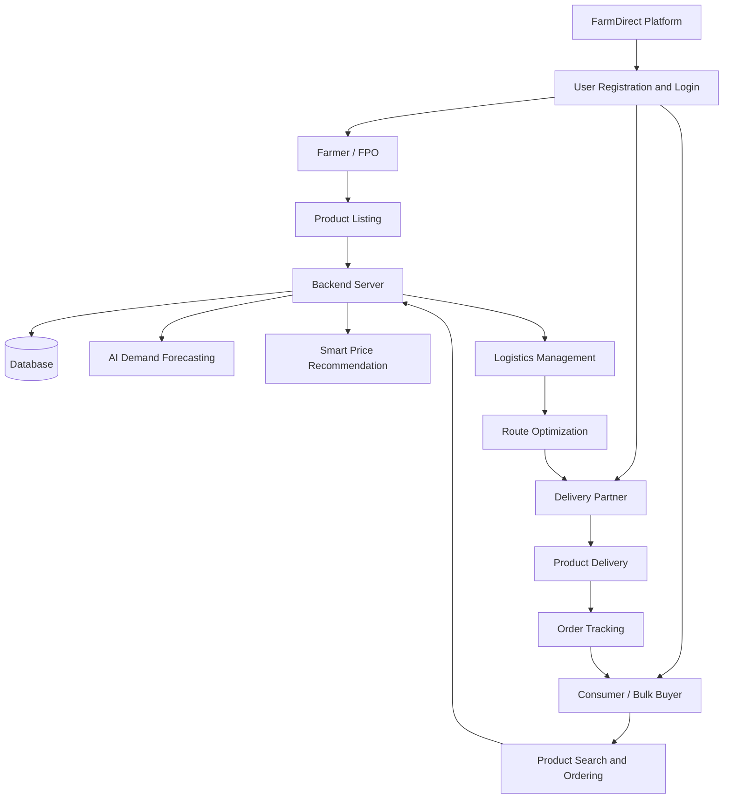
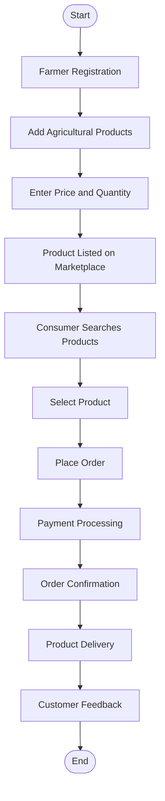
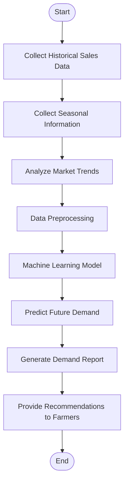
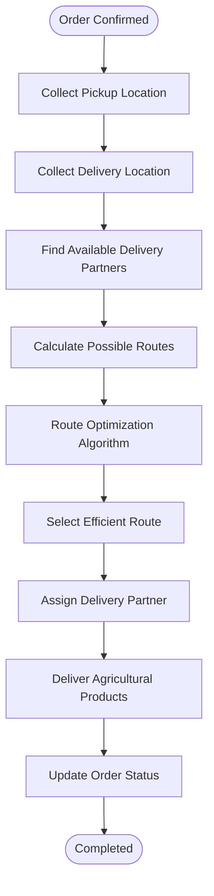

# SMART INDIA HACKATHON WORKSHOP 2026

## Student Details

| Field | Details |
|---|---|
| Date | 24-11-2026 |
| Reference Number | SIH 26033 |
| Name | Kishore |
| Register Number | 26018369 |

---

# 🌾 FarmDirect – AI-Powered Agricultural Marketplace

## Problem Details

| Field | Description |
|---|---|
| Problem ID | SIH 26033 |
| Problem Title | Multiple intermediaries reduce farmers' earnings and increase consumer prices |
| Problem Creator's Organization | Ministry of Consumer Affairs, Food & Public Distribution |
| Theme | Agriculture, FoodTech & Rural Development |
| Proposed Project | FarmDirect |

---

# 1. PROPOSED SOLUTION

## 1.1 Detailed Explanation of the Proposed Solution

FarmDirect is an AI-powered digital agricultural marketplace designed to connect farmers, Farmer Producer Organizations (FPOs), consumers, retailers, and bulk buyers through a single online platform.

The main objective is to eliminate unnecessary intermediaries in the agricultural supply chain and create a direct connection between producers and buyers.

The platform provides the following features:

- **Direct Farmer-to-Consumer Marketplace:** Farmers can upload agricultural products, set prices, and sell directly to consumers.
- **FPO Integration:** Farmer Producer Organizations can register and sell products collectively.
- **AI-Based Demand Forecasting:** Predicts future demand by analyzing historical sales, seasonal trends, and market data.
- **Smart Price Recommendation:** Suggests suitable selling prices based on market conditions and product availability.
- **Logistics Support:** Connects farmers with delivery partners and transportation services.
- **Bulk Ordering:** Enables supermarkets, hotels, retailers, and wholesalers to purchase directly from farmers.
- **Real-Time Order Tracking:** Allows customers to track products from the farm to their destination.
- **Multilingual Support:** Supports regional languages to make the platform accessible to rural farmers.

## 1.2 How It Addresses the Problem

The traditional agricultural supply chain involves multiple intermediaries, resulting in higher prices for consumers and lower profits for farmers.

FarmDirect addresses these problems by:

1. Connecting farmers directly with consumers and bulk buyers.
2. Reducing unnecessary intermediaries and additional commissions.
3. Providing transparent product pricing.
4. Using AI to predict demand and minimize agricultural wastage.
5. Providing efficient transportation and delivery management.
6. Supporting secure digital transactions.
7. Improving farmers' access to local and distant markets.

This approach creates a more transparent, affordable, and efficient agricultural supply chain.

## 1.3 Innovation and Uniqueness of the Solution

FarmDirect combines Artificial Intelligence, digital trading, and logistics management into one integrated agricultural platform.

Its unique features include:

- AI-based agricultural demand forecasting.
- Intelligent farmer-to-buyer matching.
- Market-based price recommendations.
- Optimized transportation routes.
- Combined delivery for nearby customer orders.
- Digital product quality and origin information.
- Voice-assisted product listing for farmers.
- Regional language support.
- Transparent farmer and buyer ratings.

The platform focuses on improving the entire agricultural supply chain rather than providing only an online shopping facility.

---

# 2. TECHNICAL APPROACH

## 2.1 Technologies to Be Used

The following technologies are proposed for developing the FarmDirect platform.

### Frontend Technologies

| Technology | Purpose |
|---|---|
| HTML5 | Structure of web pages |
| CSS3 | Website styling and design |
| JavaScript | Frontend functionality |
| React.js | Interactive user interface |

### Backend Technologies

| Technology | Purpose |
|---|---|
| Python | Backend development and AI |
| Flask | Backend API development |
| REST API | Communication between frontend and backend |

### Database Technologies

| Technology | Purpose |
|---|---|
| MySQL | Stores user and product information |
| PostgreSQL | Alternative relational database |

### AI and Machine Learning

| Technology | Purpose |
|---|---|
| NumPy | Numerical calculations |
| Pandas | Data analysis |
| Scikit-learn | Machine learning |
| Python | AI model development |

### Logistics and Development Tools

| Technology | Purpose |
|---|---|
| Google Maps API | Mapping and location services |
| OpenStreetMap | Geographical information |
| Git | Version control |
| GitHub | Project collaboration and hosting |
| Cloud Hosting | Application deployment |

## 2.2 Methodology and Process for Implementation

The implementation process consists of the following steps:

**Step 1: User Registration**

Farmers, FPOs, consumers, retailers, and delivery partners create accounts on the platform.

**Step 2: Agricultural Product Listing**

Farmers upload product details such as product name, quantity, price, quality, and location.

**Step 3: Product Search and Discovery**

Consumers and bulk buyers search for agricultural products based on location, price, and quantity.

**Step 4: AI-Based Demand Forecasting**

The machine learning model analyzes historical sales, seasonal patterns, and customer demand to predict future requirements.

**Step 5: Smart Price Recommendation**

The system analyzes available market information and recommends suitable product prices to farmers.

**Step 6: Order Placement and Payment**

Customers select products, place orders, and complete transactions through digital payment methods.

**Step 7: Logistics Management**

The platform identifies suitable delivery partners and calculates efficient delivery routes.

**Step 8: Order Tracking**

Customers can track their orders from the farmer's location to the delivery destination.

**Step 9: Feedback and Improvement**

Customers provide ratings and feedback to improve the quality and reliability of the platform.

## 2.3 System Architecture Flowchart

## 2.4 Farmer-to-Consumer Workflow

## 2.5 AI-Based Demand Forecasting Flowchart

## 2.6 Logistics and Route Optimization Flowchart

---

# 3. FEASIBILITY AND VIABILITY

## 3.1 Analysis of the Feasibility of the Idea

FarmDirect is technically, economically, and operationally feasible because it uses existing digital technologies and infrastructure.

### Technical Feasibility

- Web technologies can be used to develop the marketplace.
- Python libraries support AI-based demand forecasting.
- Mapping services can support route optimization.
- Cloud platforms provide scalable storage and hosting.
- Digital payment gateways enable online transactions.

### Economic Feasibility

- The platform can be developed using open-source technologies.
- Farmers can access the marketplace through smartphones.
- Direct selling can reduce unnecessary supply chain expenses.
- The platform can initially operate in selected agricultural regions.

### Operational Feasibility

- Farmers and buyers can use a simple registration process.
- Local FPOs can help onboard farmers.
- Existing transportation providers can support deliveries.
- The platform can gradually expand to different districts and states.

## 3.2 Potential Challenges and Risks

1. Limited digital literacy among rural farmers.
2. Poor internet connectivity in certain rural areas.
3. Maintaining agricultural product quality during transportation.
4. Fluctuations in agricultural market prices.
5. Security and trust issues in online transactions.
6. Availability of reliable transportation services.
7. Difficulty predicting demand during unexpected market changes.
8. Managing orders involving different quantities and locations.

## 3.3 Strategies for Overcoming These Challenges

- Develop a simple and user-friendly interface.
- Provide regional language and voice-assisted features.
- Support low-bandwidth and mobile-friendly access.
- Collaborate with FPOs and agricultural organizations.
- Introduce product quality verification.
- Integrate secure digital payment systems.
- Partner with local transportation providers.
- Continuously update AI models with market data.
- Provide customer support and farmer training programs.

### Challenges and Solutions Table

| Challenge | Proposed Solution |
|---|---|
| Low digital literacy | Simple interface and voice assistance |
| Poor internet connectivity | Low-bandwidth application |
| Product quality issues | Quality verification system |
| Price fluctuations | Updated market information |
| Payment security | Secure payment gateway |
| Transportation problems | Local logistics partnerships |
| Demand prediction errors | Regular AI model updates |

---

# 4. IMPACT AND BENEFITS

## 4.1 Potential Impact on the Target Audience

### Farmers

- Increased earnings through direct selling.
- Reduced dependency on intermediaries.
- Better access to consumers and bulk buyers.
- Improved market opportunities.
- Transparent pricing information.

### Consumers

- Access to fresh agricultural products.
- Potentially lower purchasing costs.
- Transparent product prices.
- Convenient online ordering.
- Improved product availability.

### Farmer Producer Organizations (FPOs)

- Better market connectivity.
- Opportunities for bulk selling.
- Improved coordination among farmers.
- Access to more buyers.

### Retailers and Bulk Buyers

- Direct purchasing from agricultural producers.
- Reduced procurement complexity.
- Better product availability.
- Efficient order management.

### Delivery Partners

- More transportation opportunities.
- Better route planning.
- Improved delivery coordination.

## 4.2 Benefits of the Solution

### Social Benefits

- Supports rural farmers.
- Encourages digital literacy.
- Improves farmer-consumer relationships.
- Promotes rural development.

### Economic Benefits

- Helps improve farmers' income.
- Reduces unnecessary supply chain costs.
- Provides competitive prices to consumers.
- Creates employment opportunities in rural areas.

### Environmental Benefits

- Reduces food wastage through demand forecasting.
- Optimizes transportation routes.
- Minimizes unnecessary transportation.
- Encourages efficient use of agricultural resources.

### Technological Benefits

- Introduces AI into agricultural marketing.
- Promotes digital agricultural transformation.
- Improves supply chain transparency.
- Supports data-driven agricultural decisions.

### Impact Summary Table

| Category | Expected Benefits |
|---|---|
| Farmers | Better market access and earning opportunities |
| Consumers | Affordable and fresh agricultural products |
| FPOs | Improved bulk selling opportunities |
| Economy | Reduced supply chain inefficiencies |
| Environment | Reduced food wastage and optimized transportation |
| Technology | AI-based agricultural management |

---

# 5. RESEARCH AND REFERENCES

The FarmDirect solution is based on research into agricultural marketing, digital marketplaces, artificial intelligence, supply chain management, and transportation optimization.

## 5.1 Government and Agricultural References

1. [Ministry of Agriculture and Farmers Welfare](https://agriwelfare.gov.in/)
2. [National Agriculture Market (e-NAM)](https://www.enam.gov.in/)
3. [Ministry of Consumer Affairs](https://consumeraffairs.nic.in/)
4. [Digital India](https://www.digitalindia.gov.in/)
5. [Food and Agriculture Organization (FAO)](https://www.fao.org/)

## 5.2 Technical References

1. [Python Documentation](https://docs.python.org/3/)
2. [React Documentation](https://react.dev/)
3. [Flask Documentation](https://flask.palletsprojects.com/)
4. [NumPy Documentation](https://numpy.org/doc/)
5. [Pandas Documentation](https://pandas.pydata.org/docs/)
6. [Scikit-learn Documentation](https://scikit-learn.org/)
7. [Google Maps Platform](https://developers.google.com/maps)

---

# 6. FUTURE ENHANCEMENTS

FarmDirect can be further improved with the following features:

1. Mobile application for Android and iOS.
2. AI-powered crop demand recommendations.
3. IoT-based storage monitoring.
4. Digital quality certification.
5. Advanced agricultural market analytics.
6. Integration with additional FPOs.
7. Multilingual voice assistant.
8. Expansion to multiple states across India.
9. Improved delivery scheduling.
10. Advanced agricultural price analysis.

---

# 7. CONCLUSION

FarmDirect aims to transform the traditional agricultural supply chain into a smart, transparent, and technology-driven digital marketplace.

By connecting farmers and FPOs directly with consumers and bulk buyers, the platform aims to reduce unnecessary intermediaries, improve farmers' earnings, and make agricultural products more affordable for consumers.

The integration of Artificial Intelligence, demand forecasting, smart price recommendations, and logistics optimization will help improve supply chain efficiency and reduce agricultural wastage.

FarmDirect aims to empower farmers, support rural communities, and create a sustainable agricultural ecosystem.

### 🌱 Our Vision

**"From Farm to Consumer – Fair Prices, Fresh Products, Better Futures."**

---

## Project Summary

| Details | Information |
|---|---|
| Project Name | FarmDirect |
| Problem ID | SIH 26033 |
| Student Name | Kishore |
| Theme | Agriculture, FoodTech & Rural Development |
| Main Technology | Artificial Intelligence |
| Main Objective | Direct Farmer-to-Consumer Marketplace |

---

# 🌾 FarmDirect

### Empowering Farmers. Connecting Markets. Building a Better Future.

**Smart India Hackathon 2026**

